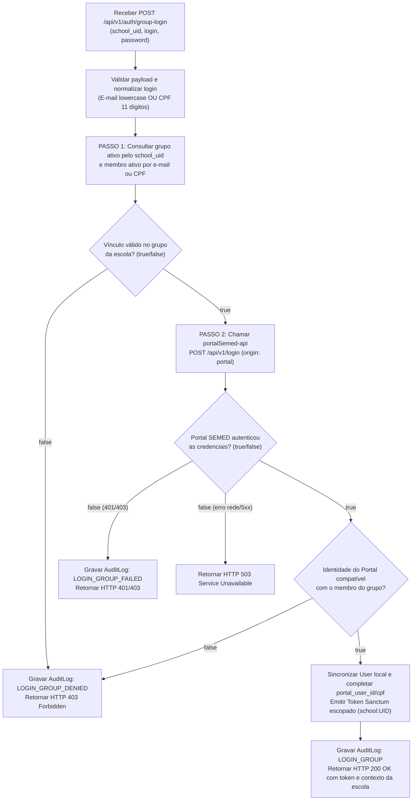
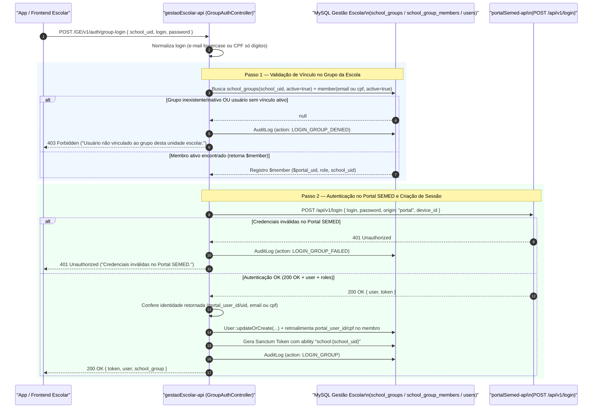
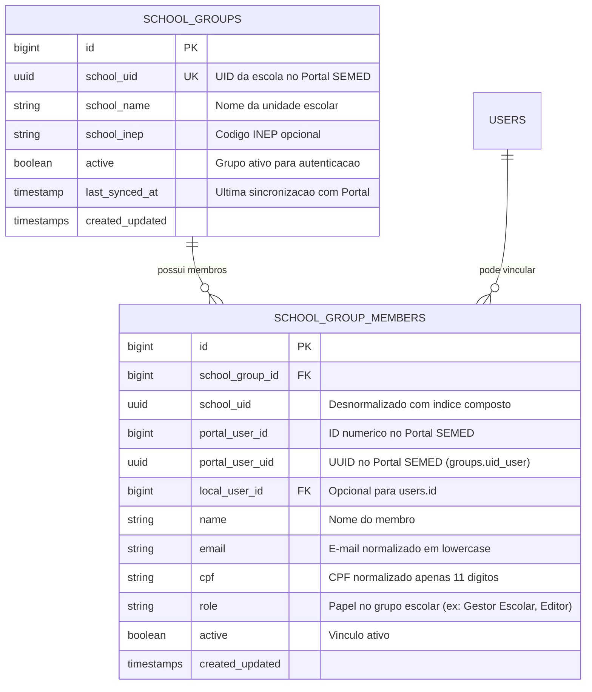

# Documento de Especificação Técnica — API de Autenticação por Grupo Escolar (2 Passos)

**Projeto:** Gestão Escolar (`gestao-escolar` / `gestaoEscolar-api`)  
**Módulo:** Autenticação Federada Vinculada a Grupos de Unidades Escolares  
**Secretaria Municipal de Educação de Vila Velha (SEMED)**  
**Versão do Documento:** 1.0.0  
**Data:** 18/11/2026  

---

## 1. Visão Geral e Objetivo

Este documento especifica a arquitetura, modelagem de dados, contratos REST (compatíveis com OpenAPI 3.0 / Swagger) e requisitos de segurança para implementação da **API de Autenticação por Grupo Escolar** no backend **Gestão Escolar (`gestao-escolar/backend-laravel`)**.

Diferente da autenticação administrativa do painel `/admin` (`POST /api/v1/auth/login` com `origin: "app"`, restrita a `Master`, `Administrador do Sistema` e `Gestor do Sistema`), a **Autenticação por Grupo** atende aplicações satélites, módulos escolares e microsserviços do ecossistema SEMED nos quais o usuário só pode iniciar sessão se:

1. **Estiver vinculado e ativo no grupo específico da escola informada** (`school_uid`), validado por **e-mail** ou **CPF**;
2. **Autenticar suas credenciais com sucesso no `portalSemed-api`**, criando a sessão autenticada (token **Laravel Sanctum** com escopo da escola) apenas após aprovação nos dois passos.

### 1.1. Entradas Obrigatórias da Autenticação

A API recebe obrigatoriamente **3 informações principais**:

| Campo | Tipo | Obrigatório | Descrição |
| :--- | :--- | :---: | :--- |
| `school_uid` | `string (UUID)` | Sim | Identificador único (`uid`) da unidade escolar vinculada ao grupo. |
| `login` | `string` | Sim | **E-mail** institucional/pessoal ou **CPF** do usuário (com ou sem máscara). |
| `password` | `string` | Sim | Senha pessoal do usuário cadastrada no Portal SEMED. |
| `device_id` | `string` | Não | Identificador opcional do dispositivo/cliente para rastreabilidade de sessão e auditoria. |

### 1.2. Contexto de Exposição e Roteamento

Seguindo o padrão do gateway Nginx (`nginx/default.conf`) e do `gestao-escolar`:

- **Rota Interna Laravel:** `/api/v1/auth/group-login`
- **Produção (Gateway Master Nginx):** `POST https://gedu.vilavelha.es.gov.br/GE/v1/auth/group-login`
- **Homologação (Gateway Master Nginx):** `POST https://gedu.vilavelha.es.gov.br/GE/dev/v1/auth/group-login`

---

## 2. Arquitetura e Fluxo de Autenticação em 2 Passos

A arquitetura adota o princípio **Fail-Fast (Validação Antecipada de Vínculo)** no Passo 1 antes de realizar qualquer chamada externa de rede no Passo 2:

- Se `school_uid` + (`e-mail` ou `cpf`) **não** constarem como vínculo ativo no grupo da escola, o fluxo é interrompido imediatamente com `403 Forbidden`, economizando chamadas ao `portalSemed-api` e evitando criação de usuários locais indevidos.
- Somente se o Passo 1 retornar `true`, o backend avança para o Passo 2, autenticando `login` + `password` no `portalSemed-api`.

### 2.1. Fluxograma Decisório



### 2.2. Diagrama de Sequência



### 2.3. Detalhamento Técnico do Passo 1 e Passo 2

#### Passo 1 — Pesquisa e Validação no Grupo Vinculado ao `school_uid`
1. **Normalização de Entrada (`login`):**
   - Se `filter_var($login, FILTER_VALIDATE_EMAIL)` for verdadeiro: normaliza com `mb_strtolower(trim($login), 'UTF-8')` e marca tipo `email`.
   - Caso contrário: remove qualquer caractere não numérico (`preg_replace('/\D/', '', $login)`), valida se possui **11 dígitos** (CPF) e marca tipo `cpf`.
2. **Consulta ao Grupo da Escola:**
   - Pesquisa na tabela `school_groups` onde `school_uid = $schoolUid` e `active = true`.
   - Pesquisa na tabela `school_group_members` onde `school_uid = $schoolUid` (ou via `school_group_id`), `active = true` e:
     - quando tipo `email`: `LOWER(email) = $normalizedEmail`
     - quando tipo `cpf`: `cpf_digits = $normalizedCpf` (coluna normalizada sem pontuação)
3. **Resultado do Passo 1:**
   - Retorna `true` apenas se o grupo escolar existir, estiver ativo e houver registro ativo do usuário no grupo.
   - Caso retorne `false`, encerra a requisição com HTTP `403` **sem consultar o `portalSemed-api`**.

#### Passo 2 — Autenticação no `portalSemed-api` e Criação de Sessão
1. **Chamada ao `portalSemed-api` com `origin: "portal"`:**
   - O `PortalSemedAuthService` existente (`app/Services/Auth/PortalSemedAuthService.php`) atualmente envia `'origin' => 'app'`, o que restringe o login no `ProjectAccessService` do `portalSemed-api` apenas às roles administrativas globais (`Master`, `Administrador do Sistema`, `Gestor de Sistema`).
   - Como usuários de grupos escolares (ex.: direção escolar, secretaria escolar, editores de conteúdo, servidores vinculados à escola) **não possuem necessariamente role administrativa global**, o novo método dedicado (`authenticateForSchoolGroup()`) deve enviar `'origin' => 'portal'` para `POST {PORTAL_SEMED_API_URL}/api/v1/login`.
   - Dessa forma, o `portalSemed-api` valida exclusivamente a autenticidade das credenciais (`login` + `password`) e status da conta, enquanto a autorização de acesso à escola fica garantida pelo **Passo 1** no `gestao-escolar`.
2. **Verificação Anti-Spoofing (Consistência Entre Passo 1 e Passo 2):**
   - Após o `200 OK` do `portalSemed-api`, o serviço confirma se os dados retornados em `$portalUser` (`id`/`uid`, `email` ou `cpf`) correspondem ao membro encontrado no Passo 1 (prevenindo inconsistências caso o usuário tenha alterado e-mail ou CPF).
   - Se o membro no grupo ainda não possuía `portal_user_id` ou `portal_user_uid` preenchido (cadastro prévio apenas por CPF/e-mail), o vínculo é completado automaticamente neste momento.
3. **Criação da Sessão (Sanctum Token + `users`):**
   - Sincroniza o usuário na tabela `users` (sem armazenar senha em texto claro), utilizando `User::updateOrCreate()`.
   - Emite um **token Laravel Sanctum** específico para o contexto escolar, com ability explícita:
     ```php
     $token = $user->createToken(
         name: "school-group:{$schoolUid}" . ($deviceId ? ":{$deviceId}" : ''),
         abilities: ["school:{$schoolUid}", 'group-auth']
     )->plainTextToken;
     ```
   - Grava trilha de auditoria em `audit_logs` com `action = 'LOGIN_GROUP'`, `resource_type = 'SchoolGroup'` e `resource_id = $schoolUid`.

---

## 3. Modelagem de Dados (MySQL — Migrations Propostas)

No ecossistema SEMED, o `portalSemed-api` já adota o modelo `Group` (`uid_user`, `uid_from_who`, `type = 'school'`, `active`), onde `uid_from_who` armazena o `uid` (UUID) da escola (`schools.uid`).

Para garantir **autonomia, baixa latência no Passo 1 e suporte nativo a busca por `e-mail` ou `cpf`**, o banco do `gestao-escolar` manterá duas novas tabelas locais (alimentadas via endpoints administrativos e/ou sincronização com o `portalSemed-api`).

### 3.1. Diagrama Entidade-Relacionamento



### 3.2. Especificação das Migrations

#### Tabela `school_groups`
- `id`: `bigIncrements`
- `school_uid`: `uuid('school_uid')->unique()`
- `school_name`: `string('school_name', 180)->nullable()`
- `school_inep`: `string('school_inep', 20)->nullable()->index()`
- `active`: `boolean('active')->default(true)->index()`
- `last_synced_at`: `timestamp('last_synced_at')->nullable()`
- `timestamps()`

#### Tabela `school_group_members`
- `id`: `bigIncrements`
- `school_group_id`: `foreignId('school_group_id')->constrained('school_groups')->cascadeOnDelete()`
- `school_uid`: `uuid('school_uid')->index()` *(mantido indexado para consulta direta no Passo 1)*
- `portal_user_id`: `unsignedBigInteger('portal_user_id')->nullable()->index()`
- `portal_user_uid`: `uuid('portal_user_uid')->nullable()->index()`
- `local_user_id`: `foreignId('local_user_id')->nullable()->constrained('users')->nullOnDelete()`
- `name`: `string('name', 180)->nullable()`
- `email`: `string('email', 180)->nullable()`
- `cpf`: `string('cpf', 11)->nullable()` *(armazenar somente os 11 dígitos numéricos)*
- `role`: `string('role', 80)->default('Membro Escolar')`
- `active`: `boolean('active')->default(true)`
- `timestamps()`

**Índices recomendados para performance e unicidade no Passo 1:**
- `$table->index(['school_uid', 'email', 'active'], 'idx_sgm_school_email_active');`
- `$table->index(['school_uid', 'cpf', 'active'], 'idx_sgm_school_cpf_active');`
- `$table->unique(['school_group_id', 'email'], 'uq_sgm_group_email');`
- `$table->unique(['school_group_id', 'cpf'], 'uq_sgm_group_cpf');`

> **Nota sobre o model `User` existente:** Em `2026_11_13_200001_add_portal_fields_to_users_table.php`, `users` já possui `portal_user_id` (`unsignedBigInteger` unique), `cpf` (`string(14)`), `roles` (`json`) e `last_login_at`. Recomenda-se adicionar opcionalmente `portal_uid` (`uuid()->nullable()->unique()`) em uma nova migration caso outros microsserviços consumam o UUID do Portal diretamente a partir de `users`.

---

## 4. Contratos da API REST e Documentação Swagger

Todas as novas rotas deverão ser registradas sob `Route::prefix('v1')` em `routes/api.php` e documentadas com PHP 8 Attributes (`use OpenApi\Attributes as OA;`) para publicação automática no `/api/documentation` via `php artisan l5-swagger:generate`.

### 4.1. Visão Geral dos Endpoints

| Método | Rota Laravel (`/api/v1`) | Rota Pública Gateway (`/GE/v1`) | Autenticação | Finalidade |
| :---: | :--- | :--- | :--- | :--- |
| `POST` | `/api/v1/auth/group-login` | `/GE/v1/auth/group-login` | Pública (`throttle:10,1`) | Executa os **2 passos** (grupo da escola + Portal SEMED) e cria a sessão Sanctum. |
| `POST` | `/api/v1/auth/group-verify` | `/GE/v1/auth/group-verify` | Bearer (`admin.role` ou Service Token) | Executa apenas o **Passo 1** (verifica se `login` pertence ao grupo de `school_uid`). |
| `GET` | `/api/v1/auth/me` | `/GE/v1/auth/me` | Bearer Sanctum | *(Existente)* Retorna dados da sessão atual (pode incluir contexto do token). |
| `POST` | `/api/v1/auth/logout` | `/GE/v1/auth/logout` | Bearer Sanctum | *(Existente)* Revoga o token Sanctum da sessão atual. |
| `GET` | `/api/v1/school-groups/{school_uid}/members` | `/GE/v1/school-groups/{school_uid}/members` | Bearer + `admin.role` | Lista membros vinculados ao grupo de uma escola. |
| `POST` | `/api/v1/school-groups/{school_uid}/members` | `/GE/v1/school-groups/{school_uid}/members` | Bearer + `admin.role` | Vincula usuário (e-mail/CPF) ao grupo de uma escola. |
| `DELETE` | `/api/v1/school-groups/{school_uid}/members/{member_id}` | `/GE/v1/school-groups/{school_uid}/members/{member_id}` | Bearer + `admin.role` | Remove/revoga membro do grupo da escola. |
| `POST` | `/api/v1/school-groups/{school_uid}/sync` | `/GE/v1/school-groups/{school_uid}/sync` | Bearer + `admin.role` | Sincroniza membros da escola a partir de `GET /api/v1/groups?uid_from_who={school_uid}&type=school` no Portal SEMED. |

---

### 4.2. Contrato Principal: `POST /api/v1/auth/group-login`

#### Request Body (`application/json`)

```json
{
  "school_uid": "9d8a12b4-4e56-4c89-a123-7890abcdef12",
  "login": "diretor.escola@semed.vilavelha.es.gov.br",
  "password": "********",
  "device_id": "web-diario-escolar-chrome"
}
```

*(Também aceita CPF formatado ou numérico no campo `login`, ex.: `"123.456.789-00"` ou `"12345678900"`.)*

#### Regras de Validação (`GroupLoginRequest`)

```php
[
    'school_uid' => ['required', 'uuid'],
    'login'      => ['required', 'string', 'max:150'],
    'password'   => ['required', 'string', 'max:150'],
    'device_id'  => ['nullable', 'string', 'max:120'],
]
```

#### Respostas Esperadas

- **`200 OK` — Autenticado nos 2 passos e sessão criada:**

```json
{
  "success": true,
  "message": "Autenticação por grupo realizada com sucesso.",
  "data": {
    "token": "12|xYz987654321AbCdEfGhIjKlMnOpQrStUv",
    "token_type": "Bearer",
    "abilities": [
      "school:9d8a12b4-4e56-4c89-a123-7890abcdef12",
      "group-auth"
    ],
    "user": {
      "id": 15,
      "portal_user_id": 842,
      "name": "Maria da Silva",
      "email": "diretor.escola@semed.vilavelha.es.gov.br",
      "cpf": "12345678900",
      "roles": ["Diretor Escolar"]
    },
    "school_group": {
      "id": 3,
      "school_uid": "9d8a12b4-4e56-4c89-a123-7890abcdef12",
      "school_name": "UMEF Alger Ribeiro Bossois",
      "member_role": "Gestor Escolar"
    }
  }
}
```

- **`403 Forbidden` — Falha no Passo 1 (Sem vínculo ativo com o grupo da escola):**

```json
{
  "success": false,
  "message": "Usuário não possui vínculo ativo no grupo da unidade escolar informada.",
  "step": "school_group_validation"
}
```

- **`401 Unauthorized` — Passo 1 aprovado, mas credenciais rejeitadas no Passo 2 (`portalSemed-api`):**

```json
{
  "success": false,
  "message": "Login ou Senha Inválidas",
  "step": "portal_semed_authentication"
}
```

- **`422 Unprocessable Entity` — Dados obrigatórios ausentes ou formato inválido (`school_uid` não é UUID, CPF inválido, etc.):**

```json
{
  "message": "The school uid field must be a valid UUID.",
  "errors": {
    "school_uid": [
      "The school uid field must be a valid UUID."
    ]
  }
}
```

- **`503 Service Unavailable` — Indisponibilidade ou timeout na comunicação com o `portalSemed-api`:**

```json
{
  "success": false,
  "message": "Não foi possível comunicar com o serviço de autenticação do Portal Semed.",
  "step": "portal_semed_authentication"
}
```

---

### 4.3. Contrato Auxiliar (Apenas Passo 1): `POST /api/v1/auth/group-verify`

Permite que outros backends ou gateways do ecossistema SEMED consultem previamente se um e-mail/CPF está ativo no grupo de determinada escola sem precisar da senha.

#### Request Body (`application/json`)

```json
{
  "school_uid": "9d8a12b4-4e56-4c89-a123-7890abcdef12",
  "login": "123.456.789-00"
}
```

#### Response (`200 OK`)

```json
{
  "success": true,
  "data": {
    "authorized": true,
    "school_uid": "9d8a12b4-4e56-4c89-a123-7890abcdef12",
    "school_name": "UMEF Alger Ribeiro Bossois",
    "member": {
      "id": 44,
      "name": "Maria da Silva",
      "email": "diretor.escola@semed.vilavelha.es.gov.br",
      "role": "Gestor Escolar"
    }
  }
}
```

*(Quando não encontrado ou inativo, retorna `200 OK` com `"authorized": false, "member": null` ou `403 Forbidden`, conforme política de consumo definida para integradores internos.)*

---

## 5. Arquitetura de Código no Backend (`gestao-escolar/backend-laravel`)

### 5.1. Estrutura de Arquivos Proposta

```text
gestao-escolar/backend-laravel/
├── app/
│   ├── Http/
│   │   ├── Controllers/Api/V1/Auth/
│   │   │   ├── AuthController.php                  # (Existente) Login administrativo /admin
│   │   │   ├── GroupAuthController.php             # [NOVO] groupLogin, groupVerify
│   │   │   └── SchoolGroupController.php           # [NOVO] CRUD membros + sync com Portal
│   │   ├── Middleware/
│   │   │   └── EnsureSchoolTokenScope.php          # [OPCIONAL] Valida tokenCan("school:{uid}")
│   │   └── Requests/Auth/
│   │       └── GroupLoginRequest.php               # [NOVO] Validação school_uid, login, password
│   ├── Models/
│   │   ├── SchoolGroup.php                         # [NOVO]
│   │   └── SchoolGroupMember.php                   # [NOVO]
│   └── Services/Auth/
│       ├── PortalSemedAuthService.php              # [EDITAR] Adicionar authenticateForSchoolGroup()
│       └── SchoolGroupAuthService.php              # [NOVO] Orquestração dos 2 passos + normalização
├── database/migrations/
│   ├── xxxx_xx_xx_create_school_groups_table.php           # [NOVO]
│   └── xxxx_xx_xx_create_school_group_members_table.php    # [NOVO]
├── routes/
│   └── api.php                                     # [EDITAR] Registrar /auth/group-login e /school-groups
└── tests/Feature/Auth/
    └── GroupAuthTest.php                           # [NOVO] Testes automatizados com Http::fake()
```

### 5.2. Implementação Referência — `PortalSemedAuthService.php`

No arquivo existente `app/Services/Auth/PortalSemedAuthService.php`, recomenda-se extrair a chamada HTTP compartilhada para um método privado `requestPortalLogin(string $login, string $password, string $origin, string $deviceId)` (evitando duplicação entre o login `/admin` e o login por grupo) e expor:

```php
/**
 * Autentica credenciais no Portal Semed sem exigir role administrativa global
 * (a autorização de vínculo escolar ocorre no Passo 1 em SchoolGroupAuthService).
 */
public function authenticateForSchoolGroup(string $login, string $password, ?string $deviceId = null): array
{
    $response = $this->requestPortalLogin(
        login: $login,
        password: $password,
        origin: 'portal',
        deviceId: $deviceId ?: 'gestao-escolar-group'
    );

    if (! $response['ok']) {
        return $response;
    }

    $portalUser = $response['user'];

    return [
        'ok' => true,
        'status' => 200,
        'user' => $portalUser,
        'roles' => $this->extractRoleNames($portalUser['roles'] ?? []),
        'portal_token' => $response['portal_token'] ?? null,
    ];
}
```

### 5.3. Implementação Referência — `SchoolGroupAuthService.php`

Responsável exclusivamente pela lógica dos **2 passos**:

```php
<?php

namespace App\Services\Auth;

use App\Models\SchoolGroupMember;
use App\Models\User;

class SchoolGroupAuthService
{
    public function __construct(
        private readonly PortalSemedAuthService $portalAuth
    ) {}

    /**
     * Passo 1: Normaliza login (e-mail ou CPF) e verifica vínculo ativo no grupo da escola.
     */
    public function verifyGroupMembership(string $schoolUid, string $rawLogin): ?SchoolGroupMember
    {
        $normalized = $this->normalizeLogin($rawLogin);

        if ($normalized['value'] === '') {
            return null;
        }

        return SchoolGroupMember::query()
            ->with('group')
            ->where('school_uid', $schoolUid)
            ->where('active', true)
            ->whereHas('group', fn ($q) => $q->where('school_uid', $schoolUid)->where('active', true))
            ->where(function ($q) use ($normalized) {
                if ($normalized['type'] === 'email') {
                    $q->whereRaw('LOWER(email) = ?', [$normalized['value']]);
                } else {
                    $q->where('cpf', $normalized['value']);
                }
            })
            ->first();
    }

    /**
     * Normaliza login identificando e-mail (lowercase) ou CPF (11 dígitos).
     *
     * @return array{type: 'email'|'cpf', value: string}
     */
    public function normalizeLogin(string $rawLogin): array
    {
        $trimmed = trim($rawLogin);

        if (filter_var($trimmed, FILTER_VALIDATE_EMAIL)) {
            return [
                'type' => 'email',
                'value' => mb_strtolower($trimmed, 'UTF-8'),
            ];
        }

        $digits = preg_replace('/\D/', '', $trimmed) ?? '';

        return [
            'type' => 'cpf',
            'value' => strlen($digits) === 11 ? $digits : '',
        ];
    }

    /**
     * Garante coerência entre o membro autorizado no Passo 1 e o usuário retornado no Passo 2.
     */
    public function matchesPortalUser(SchoolGroupMember $member, array $portalUser): bool
    {
        if ($member->portal_user_id && ! empty($portalUser['id'])) {
            return (int) $member->portal_user_id === (int) $portalUser['id'];
        }

        if ($member->portal_user_uid && ! empty($portalUser['uid'])) {
            return strcasecmp($member->portal_user_uid, (string) $portalUser['uid']) === 0;
        }

        $portalEmail = mb_strtolower(trim((string) ($portalUser['email'] ?? '')), 'UTF-8');
        $portalCpf = preg_replace('/\D/', '', (string) ($portalUser['cpf'] ?? '')) ?? '';

        if ($member->email && $portalEmail !== '' && mb_strtolower($member->email, 'UTF-8') === $portalEmail) {
            return true;
        }

        if ($member->cpf && $portalCpf !== '' && $member->cpf === $portalCpf) {
            return true;
        }

        return false;
    }

    /**
     * Cria ou atualiza o usuário local e emite token Sanctum vinculado ao grupo escolar.
     */
    public function createSessionForMember(
        SchoolGroupMember $member,
        array $portalUser,
        array $roles,
        string $loginUsed,
        ?string $deviceId = null
    ): array {
        $portalUserId = $portalUser['id'] ?? $member->portal_user_id;
        $email = $portalUser['email'] ?? $member->email ?? ($loginUsed . '@semed.local');
        $cpf = preg_replace('/\D/', '', (string) ($portalUser['cpf'] ?? $member->cpf ?? '')) ?: null;

        $user = User::updateOrCreate(
            $portalUserId ? ['portal_user_id' => $portalUserId] : ['email' => $email],
            [
                'portal_user_id' => $portalUserId,
                'name' => $portalUser['name'] ?? $member->name ?? 'Usuário Escolar SEMED',
                'email' => $email,
                'cpf' => $cpf,
                'roles' => $roles,
                'last_login_at' => now(),
            ]
        );

        // Retroalimenta identificadores caso o membro tenha sido pré-cadastrado só por e-mail/CPF
        $member->fill([
            'local_user_id' => $user->id,
            'portal_user_id' => $member->portal_user_id ?? ($portalUser['id'] ?? null),
            'portal_user_uid' => $member->portal_user_uid ?? ($portalUser['uid'] ?? null),
            'name' => $member->name ?? $user->name,
        ])->save();

        $tokenName = 'school-group:' . $member->school_uid . ($deviceId ? ':' . $deviceId : '');
        $token = $user->createToken($tokenName, [
            'school:' . $member->school_uid,
            'group-auth',
        ])->plainTextToken;

        return [
            'token' => $token,
            'user' => $user,
        ];
    }
}
```

### 5.4. Anotação Swagger (`#[OA\Post]` em `GroupAuthController.php`)

Como o projeto utiliza `darkaonline/l5-swagger` v11 com **PHP 8 Native Attributes** (`OpenApi\Attributes`), o controller `GroupAuthController` deve utilizar atributos `#[OA\Post(...)]`:

```php
#[OA\Post(
    path: '/api/v1/auth/group-login',
    tags: ['Auth (Group)'],
    summary: 'Autenticar usuário por grupo escolar (2 passos)',
    description: 'Passo 1: valida vínculo ativo do e-mail/CPF no grupo vinculado ao school_uid. Passo 2: autentica no Portal SEMED e cria sessão Sanctum.',
    requestBody: new OA\RequestBody(
        required: true,
        content: new OA\JsonContent(
            required: ['school_uid', 'login', 'password'],
            properties: [
                new OA\Property(property: 'school_uid', type: 'string', format: 'uuid', example: '9d8a12b4-4e56-4c89-a123-7890abcdef12'),
                new OA\Property(property: 'login', type: 'string', maxLength: 150, example: 'diretor.escola@semed.vilavelha.es.gov.br', description: 'E-mail ou CPF do usuário'),
                new OA\Property(property: 'password', type: 'string', format: 'password', maxLength: 150, example: '********'),
                new OA\Property(property: 'device_id', type: 'string', maxLength: 120, nullable: true, example: 'web-escolar'),
            ]
        )
    ),
    responses: [
        new OA\Response(response: 200, description: 'Autenticação realizada e sessão criada'),
        new OA\Response(response: 401, description: 'Credenciais inválidas no Portal SEMED (Passo 2)'),
        new OA\Response(response: 403, description: 'Usuário sem vínculo ativo no grupo da escola (Passo 1)'),
        new OA\Response(response: 422, description: 'Erro de validação'),
        new OA\Response(response: 503, description: 'Portal SEMED indisponível'),
    ]
)]
```

---

## 6. Segurança, Auditoria e Sincronização com Portal SEMED

### 6.1. Controles de Segurança Obrigatórios
1. **Rate Limiting:** aplicar `throttle:10,1` (por IP + `school_uid` + `login`) na rota `POST /api/v1/auth/group-login` para mitigar força bruta e abuso contra o `portalSemed-api`.
2. **Escopo de Sessão por Escola:** o token Sanctum gerado inclui a ability `school:{school_uid}`. Aplicações consumidoras ou middlewares do `gestao-escolar` podem verificar `$request->user()->tokenCan("school:{$schoolUid}")` para impedir que um token emitido na escola A acesse recursos da escola B.
3. **Sem Armazenamento de Senha Local:** a senha informada pelo usuário é encaminhada apenas em memória via HTTPS/rede interna para o `portalSemed-api` e nunca persistida no banco local (`users.password` permanece `null` para logins federados).
4. **Logs de Auditoria Unificados (`audit_logs`):**
   - `LOGIN_GROUP_DENIED`: falha no Passo 1 (registrando `school_uid`, identificador normalizado, IP e User-Agent).
   - `LOGIN_GROUP_FAILED`: Passo 1 válido, mas senha/conta recusada no Passo 2.
   - `LOGIN_GROUP`: autenticação bem-sucedida nos 2 passos (com `user_id`, `school_uid`, `member_role`).

### 6.2. Estratégia de Alimentação / Sincronização dos Grupos
Os membros vinculados a cada `school_uid` podem ser mantidos por duas vias complementares:
1. **Gestão Direta no `gestao-escolar` (`/admin`):** endpoints protegidos por `auth:sanctum` + `admin.role` para adicionar/ativar/remover usuários (via busca no Portal SEMED ou vínculo por e-mail/CPF) para cada `school_uid`.
2. **Sincronização sob demanda com o `portalSemed-api`:** consumo de `GET {PORTAL_SEMED_API_URL}/api/v1/groups?uid_from_who={school_uid}&type=school&active=1` usando Token de Serviço (`PORTAL_API_TOKEN`) configurado no `.env` do `gestao-escolar`, populando automaticamente `school_groups` e `school_group_members`.

---

## 7. Checklist de Implementação e Plano de Testes

### 7.1. Fases de Entrega

| Fase | Entregável | Critério de Pronto |
| :---: | :--- | :--- |
| **1** | Migrations e Models (`SchoolGroup`, `SchoolGroupMember`) | `php artisan migrate` executado sem erros; índices compostos criados. |
| **2** | `PortalSemedAuthService::authenticateForSchoolGroup()` e `SchoolGroupAuthService` | Passo 1 normaliza e-mail/CPF e bloqueia antes de acionar rede externa. |
| **3** | `GroupLoginRequest`, `GroupAuthController` e rotas em `routes/api.php` | Endpoints `/api/v1/auth/group-login` e `/api/v1/auth/group-verify` operacionais com auditoria. |
| **4** | Gestão de grupos (`SchoolGroupController`) e documentação Swagger (`#[OA\*]`) | `php artisan l5-swagger:generate` gerando especificações em `api-docs.json` sem erros. |
| **5** | Testes Automatizados (`tests/Feature/Auth/GroupAuthTest.php`) | Todos os cenários de Passo 1 e Passo 2 cobertos com `Http::fake()`. |

### 7.2. Matriz Mínima de Testes Automatizados (`PHPUnit`)

| Cenário | Entrada | Expectativa |
| :--- | :--- | :--- |
| **Passo 1 falso (usuário fora do grupo)** | `school_uid` válido + e-mail não cadastrado no grupo | HTTP `403`, `Http::assertNothingSent()` (Portal SEMED **não** é chamado) e log `LOGIN_GROUP_DENIED`. |
| **Passo 1 falso (membro/grupo inativo)** | `active = false` no membro ou na escola | HTTP `403`, sem chamada ao Portal SEMED. |
| **Passo 1 verdadeiro (por CPF com máscara) + senha inválida** | `login: "123.456.789-00"` existente no grupo + Portal retorna `401` | Passo 1 aprova CPF normalizado; Portal chamado 1x; HTTP `401` e log `LOGIN_GROUP_FAILED`. |
| **Passo 1 verdadeiro (por e-mail) + Passo 2 verdadeiro** | E-mail no grupo + Portal retorna `200` com `user` | HTTP `200`, token Sanctum criado com ability `school:{school_uid}`, `last_login_at` atualizado e log `LOGIN_GROUP`. |
| **Divergência de identidade entre Passo 1 e Passo 2** | Membro no grupo tem CPF X, mas Portal retorna usuário Y | HTTP `403`, token **não** é emitido. |
| **Validação de entrada inválida** | `school_uid` inválido ou campos vazios | HTTP `422` com erros de validação padrão Laravel. |

### 7.3. Comandos de Validação Pós-Implementação

```powershell
# 1. Validar sintaxe PHP dos arquivos alterados/criados
php -l app/Http/Controllers/Api/V1/Auth/GroupAuthController.php
php -l app/Services/Auth/SchoolGroupAuthService.php

# 2. Executar migrations e suíte de testes
php artisan migrate
php artisan test --filter=GroupAuthTest

# 3. Atualizar especificação Swagger (OpenAPI 3.0)
php artisan l5-swagger:generate
```
